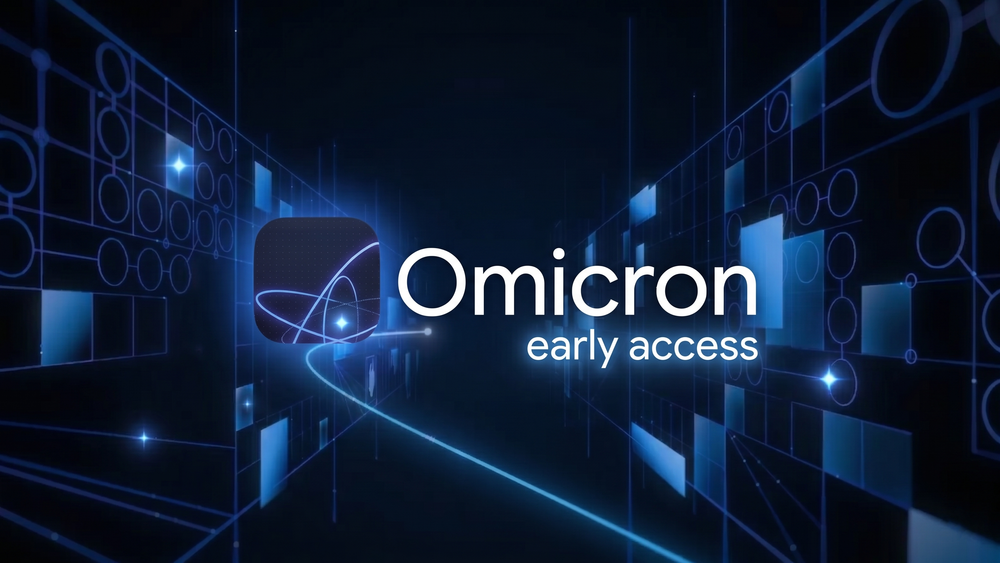
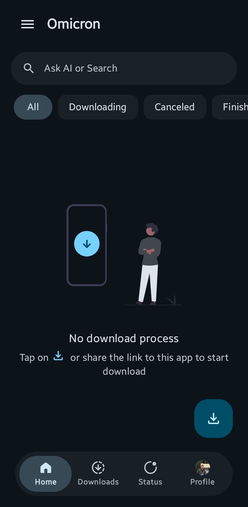
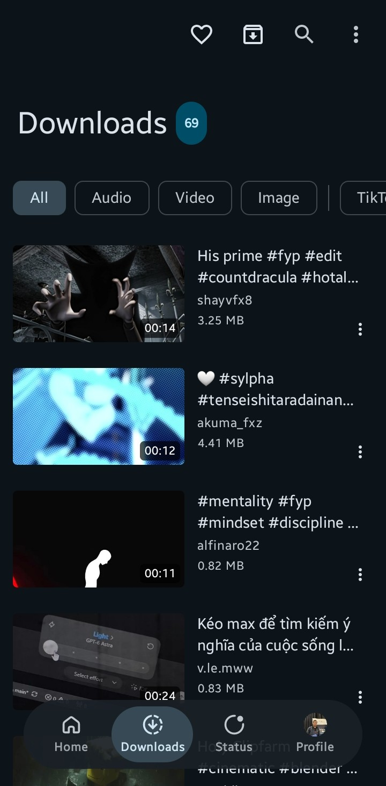
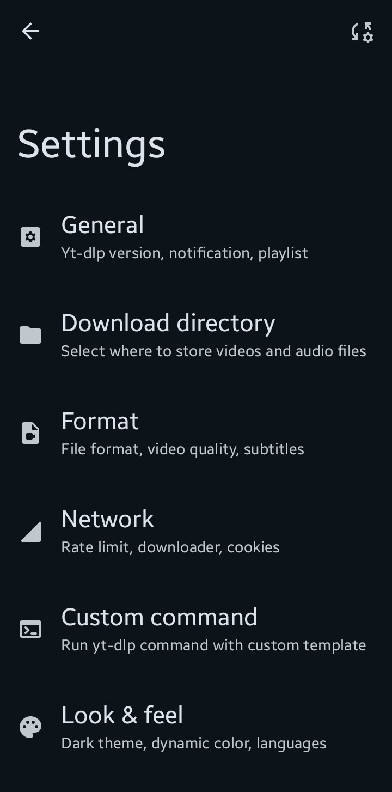
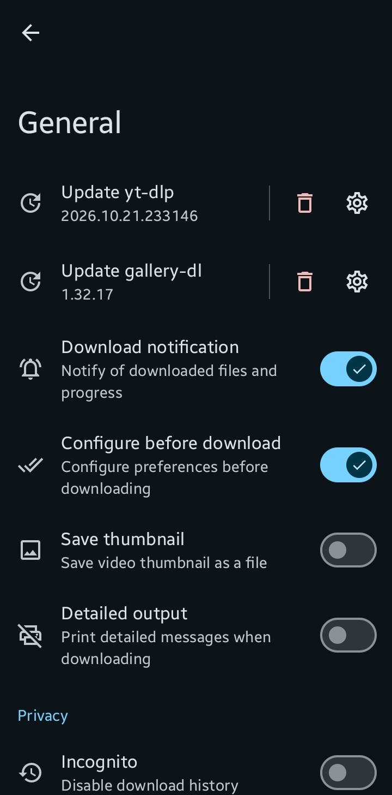
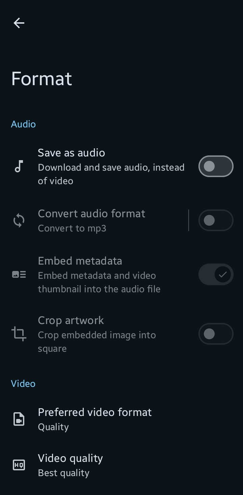
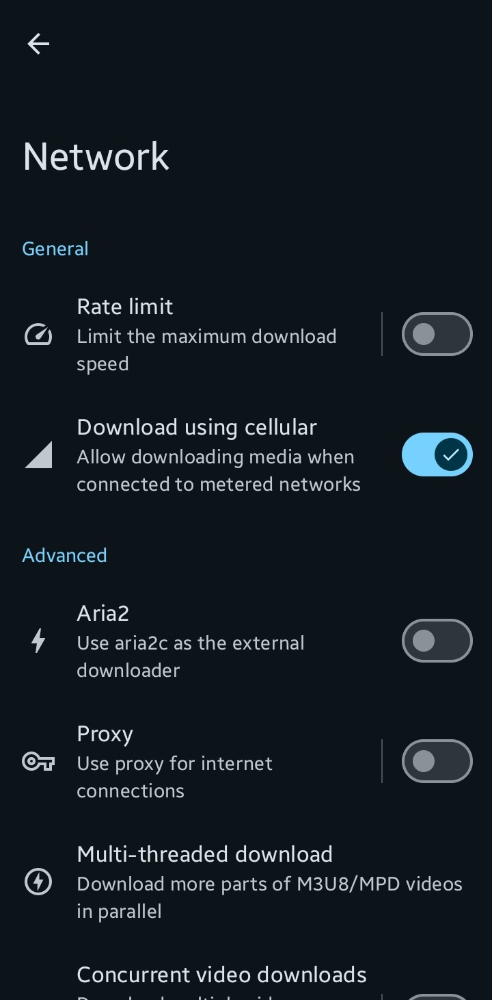
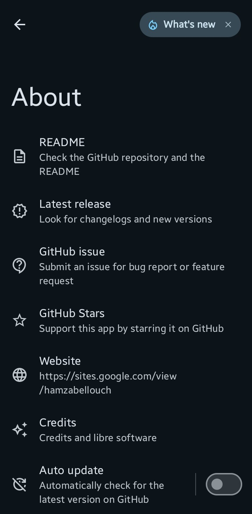

# Omicron
<h3 align="center">One Link. Infinite Media. Maximum Speed.</h3>

An open-source Android media downloader built with Jetpack Compose, powered by yt-dlp, FFmpeg, QuickJS, and Aria2c.

  

## Overview

**Omicron** is a powerful, user-friendly, and beautifully designed media downloader for Android.  
Powered by `yt-dlp`, it allows users to download videos, audio files, and entire playlists from hundreds of supported platforms while offering complete control over formats, subtitles, metadata, and custom commands.

Omicron is built using modern Android technologies and follows the principles of **Modern Android Development (MAD)** to ensure high performance, stability, and a seamless user experience.

The application focuses on simplicity, speed, and flexibility, making it suitable for both casual users and advanced users who need full control over media downloading workflows.

## Screenshots

Omicron UI & Features :

  
  
  
  
  
  
  
  
  
  
  
  
  
  

 

## ⭐ Features - Supported +1000 platform

Examples of popular platforms :

| Platform | Engine Used | Video Support | Audio Extraction | Subtitles & Metadata | Download Speed & Acceleration |
| :--- | :--- | :--- | :--- | :--- | :--- |
| **YouTube** | `yt-dlp` | Full (up to 8K, HDR, 60fps) | Full (Extracted & encoded via FFmpeg) | Automatic / Manual subtitles, embedded thumbnails & tags | **High-Speed** (Accelerated via multi-threaded `aria2c` & throttled bypass) |
| **Instagram** | `yt-dlp` | Full (Reels, Stories, IGTV, Posts) | Supported (from video posts/reels) | Post captions, cover extraction | **High-Speed** (Supports custom cookies for private content) |
| **Facebook** | `yt-dlp` | Full (Watch, Reels, Page videos) | Supported | Basic metadata extraction | **High-Speed** (Multi-quality stream selection) |
| **TikTok** | `yt-dlp` | Full (Watermark-free download option) | Supported | Creator tags, audio metadata | **Very High-Speed** (Direct CDN links) |
| **X (Twitter)** | `yt-dlp` | Full (All public video posts & GIFs) | Supported | Tweet text, thumbnail | **High-Speed** |
| **Reddit** | `yt-dlp` | Full (Muxed video + audio streams via FFmpeg) | Supported | Post metadata | **High-Speed** |

###  🛠 Tech Stack & Architecture

Omicron follows modern Android architecture principles for better maintainability and performance.

* `100% Kotlin & Coroutines / Flow` (Asynchronous programming & reactive state management)
* `Jetpack Compose` (Declarative UI Toolkit)
* `Single Activity Architecture` with Compose Navigation
* `Material Design 3` & `Dynamic Colors` (Material You theming)
* `Koin` (Dependency Injection)
* `Room Database` (Local task and download history storage)
* `MMKV` (High-performance key-value storage)
* `AndroidX WorkManager` (Background and foreground download worker management)
* `AndroidX DocumentFile` (Storage Access Framework / SAF integration)
* Core Engines:
  - `yt-dlp` (Core media extractor & downloader)
  - `aria2c` (Multi-connection download accelerator)
  - `FFmpeg` (Post-processing, audio extraction, muxing & format conversion)
  - `QuickJS` (Embedded JavaScript engine for extractor challenges)
  - `Termux Python Runtime` (Native Python execution environment on Android)
* `Coil` (Image & Thumbnail loading)
* `OkHttp` (Resilient HTTP networking & API communication)

## 🔥 Installation

1. Go to the Releases page:
   https://github.com/hamzabellouch/omicron/releases

2. Download the latest `.apk` file for your device architecture (or universal).

3. Install the application on your Android device.

4. Make sure that: `Install from unknown sources` is enabled in your Android settings.

## 🔨 Building from Source - Not available yet

>To build Omicron locally, make sure you have the latest version of Android Studio installed.
>1. Clone the repository: `git clone https://github.com/hamzabellouch/omicron.git`
>2. Open the project in Android Studio.
>3. Sync Gradle dependencies.
>4. Build and run the application on your device or emulator.

> [!WARNING]
> There is always a possibility of error, so we assume no responsibility for any inaccuracies.

###  Copyright © 2026

Thank you for checking out Omicron. If you have any feedback or suggestions, feel free to contact us:
hamzabellouchcontact@gmail.com

Stay connected and follow us on:  
[WhatsApp](https://whatsapp.com/channel/0029Vb7MArw0LKZMpjjqOk2P) | [Facebook](https://facebook.com/hamzabellouch0) | [Instagram](https://instagram.com/hamzabellouch0) | [Twitter](https://twitter.com/hamzabellouch0) | [Telegram](https://t.me/hammzabellouch) | [LinkedIn](https://www.linkedin.com/in/hamzabellouch)
